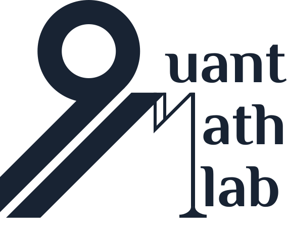

quantmathlab: A Research Library for Quantitative Finance
=========================================================

**quantmathlab** is built paper by paper. Each paper is read, its
mathematics is developed in LaTeX notes, and the methods it needs are
implemented in the library as typed, tested code behind a small and
consistent API, so that methods from different papers can be composed and
compared on the same data.

.. toctree::
   :maxdepth: 1
   :hidden:

   installation
   research/index
   modules/index
   auto_examples/index
   references
   development
   contributors

Research
--------

The :doc:`research/index` section has one entry per paper, each with a
documentation page, the compiled LaTeX notes and an executed notebook.

Package Layout
--------------

Each subpackage is an extension point. New methods land in the subpackage
whose role they fit, and new families are added as new subpackages rather
than as changes to existing ones.

.. list-table::
   :header-rows: 1
   :widths: 30 70

   * - Subpackage
     - Role
   * - :doc:`modules/models`
     - Analytic and semi-analytic pricers
   * - :doc:`modules/datasets`
     - Chain generation and loading
   * - :doc:`modules/validation`
     - Quality assessment

About
-----

**Version**: |release| (this documentation is built from the installed package,
so it always describes the version shown here and in the page footer)

**Author**: Alejandro Arias Gomez

**License**: BSD-3-Clause

**Repository**: https://github.com/aleexarias/quantmathlab

**Documentation**: not hosted yet; build it from the repository with
``cd docs && make html`` (see :doc:`installation`).

Citing quantmathlab
-------------------

If you use quantmathlab in published research, please cite:

.. code-block:: bibtex

   @software{ariasgomez_2026_quantmathlab,
     author = {Arias Gomez, Alejandro},
     title = {quantmathlab: A research library for quantitative finance},
     year = {2026},
     url = {https://github.com/aleexarias/quantmathlab}
   }

Indices and tables
==================

* :ref:`genindex`
* :ref:`modindex`
* :ref:`search`
